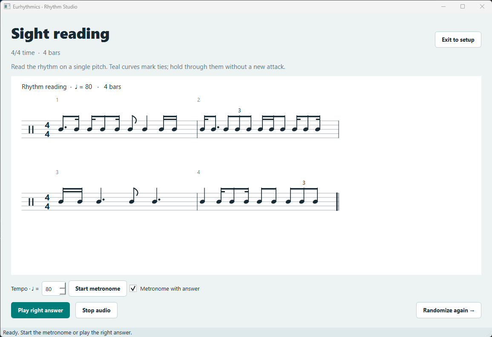

# Eurhythmics Rhythm Studio

A desktop practice app written in **Python and PyQt5**.

## Run

Use your existing Python environment containing PyQt5:

```powershell
python main.py
```

On this Windows machine, double-click **Start Rhythm Studio.bat** to use your existing Python 3.10 installation automatically.

Python 3.10 or later is required. If setting up a new environment, the only external dependency is listed in `requirements.txt`:

```powershell
python -m pip install -r requirements.txt
```

## Practice

- **Sight reading:** choose individual rhythms, a time signature, 1–32 bars, tempo, and optional ties. Start to see a randomized score. Use the metronome, change tempo, play the answer, randomize again, or exit to setup.
- **Melodic dictation:** choose rhythms, meter, bars, ties, and a tempo range. Each question picks a new melody, key, and tempo, and plays automatically. Write on paper, replay, reveal the score, or move to the next question. Replays preserve the original question exactly.
- Enable a one-bar count-in in setup. Sight reading can include metronome clicks mixed into the answer; the standalone metronome loops a complete bar with an accented downbeat.

## Rhythm vocabulary

All 18 units are individually selectable and previewed in notation:

| List | Units |
| --- | --- |
| 1 — five patterns | Half; quarter; two eighths; three eighth-note triplets; four sixteenths |
| 2 — eight patterns | Dotted quarter + eighth; dotted quarter + two sixteenths; eighth + dotted quarter; two sixteenths + dotted quarter; eighth + quarter + eighth; two sixteenths + quarter + eighth; eighth + quarter + two sixteenths; two sixteenths + quarter + two sixteenths |
| 3 — five patterns | Eighth + two sixteenths; two sixteenths + eighth; sixteenth + eighth + sixteenth; dotted eighth + sixteenth; sixteenth + dotted eighth |

Each unit stays intact inside a bar. Generation uses exact integer arithmetic and checks that each bar can be filled before starting. Patterns too long for the chosen meter are skipped. Some meters cannot be filled by these units: for example, 3/8 is one and a half quarter notes, while every specified unit lasts one or two quarter notes. The app explains incompatible selections instead of adding rhythms outside the lists.

Ties join only the final note of one unit to the first note of the next, including across barlines and score systems. Tied notes share a pitch and play as one sustained sound. When enabled, ties appear at random boundaries, with at least one if a boundary exists.

The tempo number always measures **quarter notes per minute**. The metronome clicks the denominator unit in simple meters and dotted quarters in 6/8, 9/8, and 12/8. Dictation chooses among all 15 conventional major and 15 natural-minor key signatures, with notes in C4–A5. The reveal includes the key signature, tempo, beams, dots, triplets, and ties.

Audio is synthesized locally as WAV and played through Qt Multimedia. No MIDI configuration, soundfont, or network connection is needed. Dictation is self-checking with paper transcription; it does not grade microphone input or typed answers.

## Checks

Core rhythm and audio tests need only Python:

```powershell
python -m unittest discover -v
```

An optional PyQt5 interface check is available with:

```powershell
python tests/gui_smoke.py
```

It exercises setup, score rendering, reveal, tempo changes, regeneration, and exit without audible playback, and saves previews under `test-output/`.

`python tests/playback_smoke.py` also checks real Qt audio loading, replay, metronome looping, and cancellation with the audio output muted.
